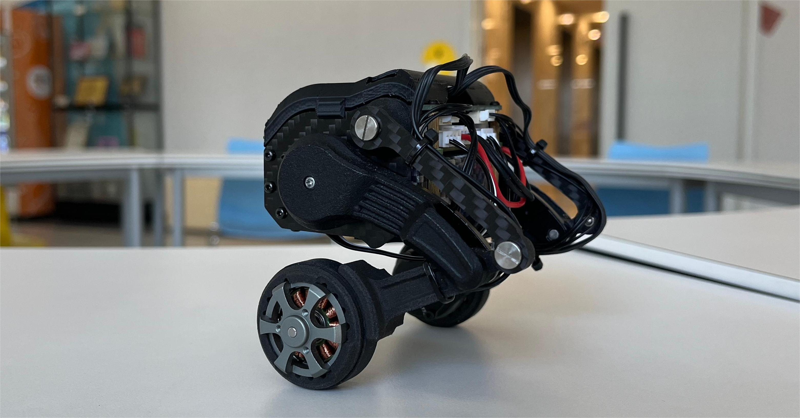
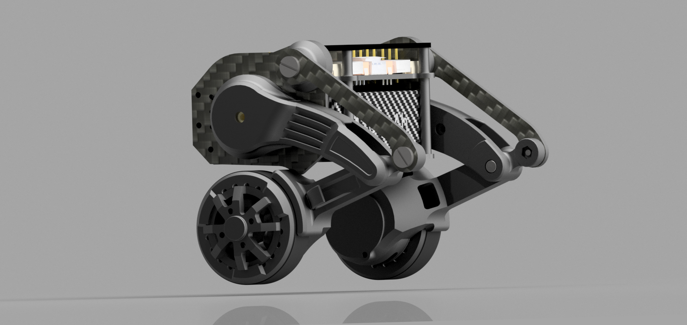
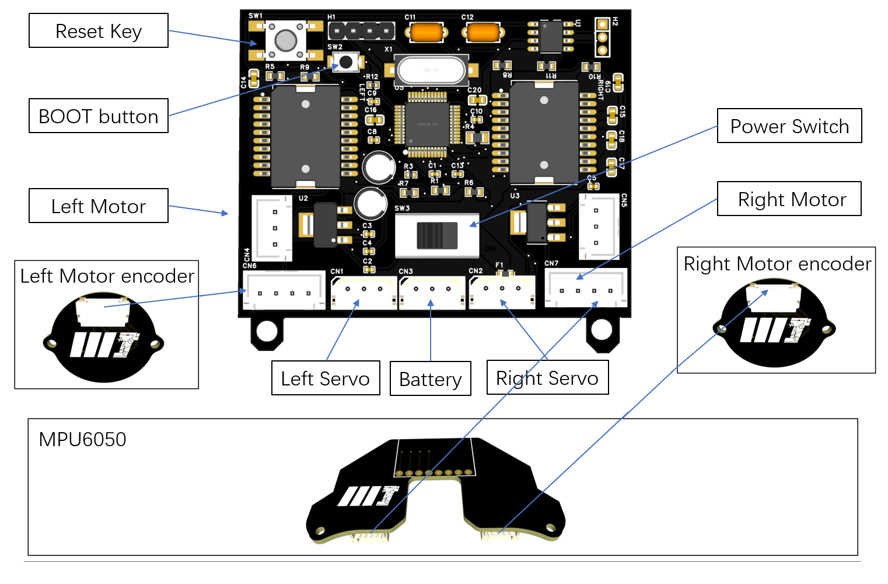

# Micro-Wheeled-Leg-Robot (STM32 版)

> **把开源轮腿机器人 [Micro-Wheeled_leg-Robot](https://github.com/MuShibo/Micro-Wheeled_leg-Robot) 的主控从 ESP32 移植到 STM32F103C8T6** —— 保留原版步态/姿态/控制算法不变，重写全部底层硬件驱动，通信方案由 WiFi+WebSocket 改为 CAN 总线。

[](https://www.st.com/en/microcontrollers-microprocessors/stm32f103c8.html)
[](https://www.keil.com/)
[](https://www.st.com/en/development-tools/stm32cubemx.html)
[](#-编译与烧录)
[](#-资源占用)
[](#-许可)

<p align="center">
  
  
</p>
<p align="center"><i>机械结构与电机/舵机沿用原版套件，本仓库只改了主控 PCB 与固件</i></p>

---

## 📖 目录

- [项目简介](#-项目简介)
- [为什么做这个移植](#-为什么做这个移植)
- [与原版的差异](#-与原版的差异)
- [硬件规格](#-硬件规格)
  - [引脚分配总表](#引脚分配总表)
  - [电路框图](#电路框图)
- [目录结构](#-目录结构)
- [软件架构](#-软件架构)
- [CAN 通信协议](#-can-通信协议)
- [编译与烧录](#-编译与烧录)
- [快速上手](#-快速上手)
- [测试例程](#-测试例程)
- [资源占用](#-资源占用)
- [设计取舍](#-设计取舍)
- [致谢](#-致谢)
- [许可](#-许可)

---

## 🔍 项目简介

这是一个**桌面级双轮腿机器人**的 STM32 固件实现。机器人本体（机械结构、无刷电机、AS5600 编码器、MPU6050、STS3032 总线舵机）全部沿用原版开源套件，本仓库的工作是：

1. **重新设计主控 PCB**：把 ESP32 换成 STM32F103C8T6，用 **CAN 总线（TJA1050）** 替代 WiFi，解决原版依赖 WiFi 遥控、无法接入上位机/其他控制器的问题；
2. **重写全部底层驱动**：L6234 三相无刷驱动、AS5600 磁编码器、MPU6050 姿态、STS3032 半双工总线舵机、TJA1050 CAN 收发；
3. **原封不动保留上层算法**：LQR 自平衡、YAW 转向、腿部高度自适应、跳跃逻辑，以及所有 PID / 低通滤波器系数——**一行未改**。

机器人可以实现：**原地站立自平衡、前后直线运动、原地转向、机身高度调节、跳跃**。

---

## 💡 为什么做这个移植

原版基于 ESP32 + Arduino IDE，非常优雅，但在工程化时会遇到几个瓶颈：

| 原版痛点 | 本项目方案 |
|---|---|
| 依赖 WiFi 遥控，延迟高（10~50ms 抖动），且需要手机/电脑连热点 | **CAN 总线 500kbps**，帧间隔可做到 <1ms，可直接接工业上位机、树莓派、ROS 节点 |
| 控制循环周期不稳定（WiFi 协议栈会打断 loop），影响互补滤波与 PID 的 dt | **TIM4 硬件 1kHz 定周期**，周期抖动只有几十 ns |
| Arduino `loop()` 是单线程大循环，没有明确的任务边界 | 中断只置标志，控制逻辑集中在 1kHz 任务，时序可预测 |
| ESP32 的 ADC 有非线性，需要 `esp_adc_cal` 曲线校准 | STM32F103 的 12bit ADC 线性度好，配合 55.5 周期采样时间足够用 |
| 无 CAN、无 StdPeriph 生态，难以接入车载总线 | F103 自带 CAN 控制器，只加一颗 TJA1050 |

同时，STM32F103C8T6 是**性价比极高、资料最全**的入门 MCU（约 ¥6），让这个项目的复刻门槛进一步降低。

---

## ⚖️ 与原版的差异

### 算法层：**完全保留**（这是本项目的核心约束）

| 模块 | 处理方式 |
|---|---|
| PID 控制器 | **逐行复刻** SimpleFOC 的 `pid.cpp`（Tustin 梯形积分、积分值限幅、输出速率限幅、`Ts>0.5` 异常保护） |
| 一阶低通滤波器 | **逐行复刻** SimpleFOC 的 `lowpass_filter.cpp`（含 `dt>0.3` 时直接输出的特殊分支） |
| IMU 姿态解算 | **逐行复刻** `MPU6050_tockn`：互补滤波系数 0.98/0.02、灵敏度 `/65.5` 与 `/16384`、加速度角公式 `atan2(accY, accZ+|accX|)×360/2/π`（含 Y 轴取负）、`(raw+12412)/340` 温度换算 |
| LQR 自平衡 | `Controller_LqrBalanceLoop()` ↔ 原版 `lqr_balance_loop()` 逐行对应 |
| YAW 转向 | `Controller_YawLoop()` / `Controller_YawAngleAddup()` 逐行对应 |
| 腿部高度 + 横滚平衡 | `Controller_LegLoop()` 逐行对应（含 2110/2510/1586/1986 硬限幅） |
| 跳跃逻辑 | `Controller_JumpLoop()` 逐行对应（含 30/35/40/200 计数分支） |
| 全部系数 | 9 个 PID + 3 个低通滤波器的系数**一字未改**；零点常量 `angle_zeropoint=-2.25`、`distance_zeropoint=-256.0`、`YAW_angle_zero_point=-10` 保持原值 |
| 电机调制 | 逐行复刻 SimpleFOC 的 **SinePWM** 分支（Inverse Park → 中心 Vs/2 → Clarke → 限幅 `[0,Vs]` → 占空比），**未引入 SVPWM 零序注入**，保证电压利用率与原版一致 |

### 硬件层：**完全重写**

| 项目 | 原版（ESP32） | 本项目（STM32F103C8T6） |
|---|---|---|
| 电机驱动 | `BLDCDriver3PWM`（LEDC 任意引脚 PWM + 独立 EN 脚） | **L6234 三半桥**：TIM1/TIM2 各 3 路 PWM 驱 EN，3 个 GPIO 控 IN |
| PWM 频率 | SimpleFOC 默认 ~25kHz | **20kHz**（Prescaler=0, Period=3599），无啸叫 |
| 编码器 | `MagneticSensorI2C` + 任意映射 Wire | **AS5600 自研驱动**，I2C2（左）/ I2C1（右），保留原版跨圈判定算法 |
| IMU | `MPU6050_tockn` | **自研驱动**，与右编码器共用 I2C1 |
| 舵机 | `Serial2` + `SCSerial`（Stream 收发） | **USART1 单线半双工** + 复用开漏，**无需方向控制引脚** |
| 舵机调速 | 1 Mbps | 1 Mbps（`72MHz / 1Mbps = BRR 72`，**误差 0%**） |
| 通信 | WiFi AP/STA + WebSocket + JSON | **CAN 500kbps**（TJA1050），自定义 8 字节报文 |
| 调试输出 | `Serial` 打印 | CAN 状态帧上报（板载唯一 UART 已给舵机） |
| 控制周期 | 不定（WiFi 会打断） | **TIM4 硬件 1kHz** |

### 有意的行为差异（仅 3 处）

| # | 差异 | 原因 |
|---|---|---|
| 1 | 控制周期从"不定"改为**固定 1kHz** | 原版 dt 来自 `millis()` 差分（可变）。20kHz PWM 下循环抖动会让互补滤波积分不稳定，必须定周期。**已与作者确认** |
| 2 | 腿部舵机从"每循环一次"降到 **200Hz** | 1Mbps 下一帧同步写约 110µs。1kHz 发送会把总线占用推到 11% 并挤占控制时间；200Hz 对腿部响应无影响，总线占用降到 2% |
| 3 | 电角度对齐扫描步数 500→200（每步仍 2ms） | 两电机对齐+零偏标定总启动时间从约 4.1s 缩到约 3s，便于扶稳机器人。扫描仍是**完整一个电周期**，精度不受影响 |

---

## 🔧 硬件规格

| 项目 | 规格 |
|---|---|
| 主控 | STM32F103C8T6（LQFP48，Cortex-M3 @72MHz，64KB Flash / 20KB RAM，8MHz HSE） |
| 电机驱动 | 2× **L6234PD013TR**（三相半桥，5A，7~42V，带 SENSE 电流采样） |
| 电流采样 | 100mΩ 采样电阻（`FRL0603FR100TS`）→ PA4 / PA5（1 LSB ≈ 8.06 mA） |
| 编码器 | 2× **AS5600**（12bit 磁编码器，I2C，0.088°/LSB） |
| IMU | **MPU6050**（I2C，与右编码器共用总线） |
| 舵机 | 2× **FEETECH STS3032** 总线舵机，半双工单总线，1Mbps，并联 ID 1/2 |
| CAN 收发 | **TJA1050T**（5V 供电，板载 120Ω 终端电阻焊盘，经跳线可选接入） |
| 电源 | 7~9V 锂电池 → 板上总开关 + 3A 保险丝 → AMS1117-5.0（舵机/CAN）→ AMS1117-3.3（主控/传感器） |
| 调试接口 | SWD（4Pin 排针） |
| 工具链 | STM32CubeMX 6.15 + Keil MDK V5.32（ARMCC V5.06u5） |

### 引脚分配总表

| 引脚 | 功能 | 网络名 / 丝印 |
|---|---|---|
| **左电机（插口 1，L6234）** | | |
| PA0 | TIM2_CH1 PWM | EN1 |
| PA1 | GPIO 输出 | IN1 |
| PA2 | TIM2_CH3 PWM | EN2 |
| PB0 | GPIO 输出 | IN2 |
| PA3 | TIM2_CH4 PWM | EN3 |
| PB1 | GPIO 输出 | IN3 |
| **右电机（插口 2，L6234）** | | |
| PA8 | TIM1_CH1 PWM | EN1 |
| PB12 | GPIO 输出 | IN1 |
| PA9 | TIM1_CH2 PWM | EN2 |
| PB13 | GPIO 输出 | IN2 |
| PA10 | TIM1_CH3 PWM | EN3 |
| PB14 | GPIO 输出 | IN3 |
| **编码器** | | |
| PB10 / PB11 | I2C2 SCL / SDA | 插口 3 · 左 AS5600 |
| PB8 / PB9 | I2C1 SCL / SDA | 插口 4 · 右 AS5600 + MPU6050 |
| **总线舵机** | | |
| PB6 | USART1 单线半双工（复用开漏） | 插口 5 · STS3032 总线 DATA |
| **采样** | | |
| PA4 | ADC1_IN4 | 左电机电流（SENSE） |
| PA5 | ADC1_IN5 | 右电机电流（SENSE） |
| PA6 | ADC1_IN6 | 电池电压分压 |
| **通信 / 调试** | | |
| PA11 / PA12 | CAN1_RX / CAN1_TX | TJA1050 |
| PA13 / PA14 | SWDIO / SWCLK | SWD 调试口 |
| PC13-PC14 / PD0-PD1 | LSE / HSE | 晶振 |
| BOOT0 | BOOT0 | 10k 下拉 + 按键上拉（模式切换） |

### PCB 设计文档
需要制作四块PCB，电路板提供原理图和PCB源文件，使用的开发环境为嘉立创EDA。  
主控板基于stm32f103c8t6，无刷电机驱动芯片为L6234PD013TR。  
编码器芯片采用AS5600，通过I2C接口与主控板通信。  
惯性测量单元（IMU）使用MPU6050模块，与右侧编码器共用同一I2C接口。  
舵机调试板将两条串行线统一为一条信号线，通过时分复用方式完成数据的收发。  
此外，还需准备三根GH1.25 4PIN双头线缆，建议长度为15厘米，需另行购买。
<p align="center">
  
</p>


### 电路框图

```
                  ┌──────────────────────────────────────┐
   7~9V 电池 ──┬──┤ F1(3A) ── AMS1117-5V ──┬─ STS3032 ×2 │
              │   │                       ├─ TJA1050    │
              │   │   AMS1117-3.3V ──┬────┤             │
              │   │                  │    │             │
              │   └──────────────────┼────┤             │
              │                      │    │ STM32F103C8 │
              │    ┌── L6234 (左) ───┘    │             │
              ├────┤   EN1/2/3 ← TIM2 ────┤ PA0/PA2/PA3 │
              │    │   IN1/2/3 ← GPIO ────┤ PA1/PB0/PB1 │
              │    │   SENSE ──── ADC ────┤ PA4         │
              │    └── 无刷电机 (左)       │             │
              │                           │             │
              ├────┬── L6234 (右) ────────┤ PA8/PA9/PA10│
              │    │   EN1/2/3 ← TIM1     │ PB12/13/14  │
              │    │   SENSE ──── ADC ────┤ PA5         │
              │    └── 无刷电机 (右)       │             │
              │                           │             │
              │    AS5600(左) ←── I2C2 ───┤ PB10/11     │
              │    AS5600(右) ←── I2C1 ───┤ PB8/9       │
              │    MPU6050   ←── I2C1 ────┤             │
              │                           │             │
              └──── 分压 30k/10k ── ADC ─┤ PA6         │
                                          │             │
                    USB-CAN ── TJA1050 ──┤ PA11/PA12   │
                                          │             │
                              SWD 调试 ──┤ PA13/PA14   │
                                          └─────────────┘
```

---

## 📁 目录结构

```
.
├── balanced_robots/                   # ★ Keil MDK 工程（CubeMX 生成 + 本项目代码）
│   ├── balanced_robots.ioc            # CubeMX 工程文件（引脚/时钟/外设配置）
│   ├── Core/
│   │   ├── Inc/                       # CubeMX 生成的头文件
│   │   └── Src/
│   │       ├── main.c                 # ★ 主框架（初始化 + 1kHz 控制循环）
│   │       ├── stm32f1xx_it.c         # * 中断（SysTick 毫秒时基 + CAN1_RX0）
│   │       ├── adc.c / can.c / i2c.c / tim.c / usart.c / gpio.c
│   │       └── system_stm32f1xx.c
│   ├── Hardware/                      # ★ 底层硬件驱动层（本项目新写）
│   │   ├── robot_config.h             #   全局配置入口：所有引脚宏 + 参数宏 + 保护阈值
│   │   ├── hardware.c / .h            #   公共底座：DWT 微秒时基、I2C 死锁恢复
│   │   ├── l6234.c / .h               #   L6234：3相PWM + 方向 + ADC电流 + 三级过流保护
│   │   ├── as5600.c / .h              #   AS5600：双路 I2C、跨圈累计、电角度换算
│   │   ├── mpu6050.c / .h             #   MPU6050 + 姿态解算（复刻 MPU6050_tockn）
│   │   ├── sts3032.c / .h             #   STS3032 半双工总线舵机（复刻 SCS/SMS_STS 协议）
│   │   └── can_proto.c / .h           #   TJA1050 CAN：指令解析 + 状态上报
│   ├── Control/                       # ★ 控制层（本项目新写，算法搬运自原版）
│   │   ├── motor.c / .h               #   电机层：电压模式3相开环 + AS5600电角度闭环 + 上电对齐
│   │   ├── controller.c / .h          #   LQR / YAW / 腿部 / 跳跃（原版逐行搬运）
│   │   └── selftest.c / .h            #   8 个单模块测试用例
│   ├── Drivers/                       # STM32F1 HAL 库 + CMSIS（ST 官方）
│   └── MDK-ARM/
│       ├── balanced_robots.uvprojx    # ★ Keil 工程文件
│       └── balanced_robots/           # 编译产物（.hex 在此）
│
├── PORTING_GUIDE.md                   # ★ 移植说明：CubeMX 要点 + 改动点对照 + 测试说明
├── HARDWARE_REVIEW.md                 # 硬件核对记录：引脚确认表 + 发现的问题
├── GITHUB_DESCRIPTION.md              # 仓库简介 / Topics / 上传步骤 / 分享文案
├── docs/images/                       # README 用图（实物、渲染、接线）
└── Micro-Wheeled_leg-Robot-master/    # 原版工程（机械图纸 / PCB 源文件 / 原版 ESP32 代码）
```

> 标注 ★ 的是本项目的核心内容；本仓库只改动主控 PCB 与固件，**机械结构与外购件请参考原版仓库**。

---

## 🏗 软件架构

分三层，依赖方向严格单向：`control → hardware → HAL`。

```
┌──────────────────────────────────────────────────────────────┐
│  应用层  main.c                                               │
│  · 初始化编排（对应原版 setup()）                              │
│  · 1kHz 控制循环 Robot_Loop()（对应原版 loop() 的 9 个步骤）    │
└───────────────────────────┬──────────────────────────────────┘
                            │
┌───────────────────────────▼──────────────────────────────────┐
│  控制层  Control/                                             │
│  ├── controller.c    PID / LPF / LQR / YAW / 腿部 / 跳跃       │
│  │                   （算法逐行搬运自原版，系数未改）            │
│  └── motor.c         电压模式 3 相开环 + AS5600 电角度闭环      │
│                      · 复刻 SimpleFOC SinePWM 调制             │
│                      · 复刻 initFOC() 扫描法电角度对齐          │
│                      · 对外暴露 motor.target / shaft_angle /   │
│                        shaft_velocity（与 SimpleFOC 同名同义）  │
└───────────────────────────┬──────────────────────────────────┘
                            │
┌───────────────────────────▼──────────────────────────────────┐
│  硬件层  Hardware/          （每个模块独立 .c/.h，互不耦合）     │
│  ├── robot_config.h   ★ 唯一配置入口                           │
│  ├── hardware.c       时基 / I2C 恢复                          │
│  ├── l6234.c          PWM + 方向 + ADC + 过流保护              │
│  ├── as5600.c         I2C 编码器                               │
│  ├── mpu6050.c        IMU + 互补滤波                           │
│  ├── sts3032.c        半双工总线舵机协议                        │
│  └── can_proto.c      CAN 收发 + 协议                          │
└───────────────────────────┬──────────────────────────────────┘
                            │
┌───────────────────────────▼──────────────────────────────────┐
│  驱动层  Core/Src + Drivers/   ****** STM32 HAL 库（CubeMX 生成）│
└──────────────────────────────────────────────────────────────┘
```

**设计原则**

- **单一配置入口**：改引脚、改波特率、改保护阈值、改控制频率，全部只动 `Hardware/robot_config.h`；
- **中断零耗时**：`TIM4_IRQHandler`（1kHz 节拍）和 `USB_LP_CAN1_RX0_IRQHandler` 都只置标志/搬运数据，所有耗时逻辑在主循环；
- **驱动不阻塞**：I2C/UART 全部带超时，失败时保持上一帧数据并尝试恢复总线，绝不返回 0 造成控制量跳变；
- **安全默认**：上电时 PWM 占空比为 0、L6234 的 IN 脚为低 → 电机完全不输出，防止上电抖动。

---

## 📡 CAN 通信协议

**物理层**：500 kbps，标准帧（11 位 ID），两端各 120Ω 终端电阻。
位时序：`APB1=36MHz, Prescaler=4, BS1=10TQ, BS2=5TQ, SJW=1TQ` → 位时间 16 TQ，**采样点 68.75%**。

### 0x200 — 上位机 → 机器人（控制指令，8 字节）

字段与移植前 WebSocket JSON 一一对应：

| Byte | 字段 | 类型 | 说明 |
|---|---|---|---|
| 0 | `dir` | uint8 | 运动状态：0=前进 1=后退 2=右转 3=左转 4=停止 5=跳跃 |
| 1 | `height` | uint8 | 机身高度（默认 38，范围约 32~64） |
| 2 | `roll` | int8 | 期望横滚（有符号） |
| 3 | `linear` | int8 | 前后平移量（有符号） |
| 4 | `angular` | int8 | 旋转量（有符号） |
| 5 | `stable` | uint8 | 1 = 使能平衡输出（对应原版 `wrobot.go`） |
| 6 | `joy_x` | int8 | 左右摇杆 → 控制 YAW |
| 7 | `joy_y` | int8 | 前后摇杆 → 控制前后运动 |

### 0x100 — 机器人 → 上位机（姿态帧，8 字节，50Hz）

| Byte | 字段 | 类型 | 单位 |
|---|---|---|---|
| 0-1 | 平衡角（pitch） | int16 BE | 0.01° |
| 2-3 | 平衡角速度（gyro Y） | int16 BE | 0.01°/s |
| 4-5 | 左轮转速 | int16 BE | 0.01 rad/s |
| 6-7 | 右轮转速 | int16 BE | 0.01 rad/s |

### 0x101 — 机器人 → 上位机（状态帧，8 字节，50Hz）

| Byte | 字段 | 类型 | 单位 |
|---|---|---|---|
| 0-1 | 左电机电流（绝对值） | uint16 BE | mA |
| 2-3 | 右电机电流（绝对值） | uint16 BE | mA |
| 4-5 | 电池电压 | uint16 BE | mV |
| 6 | 状态位 | uint8 | 见下表 |
| 7 | 舵机通信错误计数 | uint8 | 低 8 位 |

**状态位（Byte 6）**

| bit | 含义 |
|---|---|
| 0 | MPU6050 在线 |
| 1 | 左 AS5600 在线 |
| 2 | 右 AS5600 在线 |
| 3 | 左电机过流保护触发 |
| 4 | 右电机过流保护触发 |
| 5 | 电池低压（< 7.8V） |
| 6 | 舵机总线异常 |
| 7 | 保留 |

> 用 `python-can` 十几行代码就能做一个上位机遥控器，也可以直接接 USB-CAN 分析仪观察曲线。

---

## 🔨 编译与烧录

### 环境要求

| 工具 | 版本 | 备注 |
|---|---|---|
| STM32CubeMX | 6.15（或 ≥6.10） | 用于修改外设配置；`.ioc` 已提供 |
| Keil MDK-ARM | **V5.32**，ARMCC **V5.06u5** | 工程按 AC5 配置；用 AC6 需要自行调整 |
| STM32F1 器件包 | `Keil.STM32F1xx_DFP 2.3.0` | **烧录必需**，编译可不需要 |
| ST-Link | V2 及以上 | SWD 4 线连接 |

### 命令行编译（CI 友好）

```powershell
# ⚠️ 必须先设置 TMP！否则 armcc 会报：
#    #564: cannot open embedded assembler output file "\pXXXX-2"
$env:TMP = "$env:LOCALAPPDATA\Temp"
& 'D:\keil5\UV4\UV4.exe' -b '.\balanced_robots\MDK-ARM\balanced_robots.uvprojx' -j0 -o build.log
```

**成功输出**：

```
Program Size: Code=24668 RO-data=396 RW-data=948 ZI-data=2212
".\balanced_robots\balanced_robots.axf" - 0 Error(s), 0 Warning(s).
```

烧录产物：`balanced_robots/MDK-ARM/balanced_robots/balanced_robots.hex`


## 🚀 快速上手

### 1. 硬件准备

- 按原版仓库加工/采购机械结构件与电机、舵机、传感器；
- 打样本仓库的主控 PCB（原理图/PCB 源文件见原版 `2.Hardware`，本仓库对应的是 STM32 版本）；
- 舵机配置：用 [FEETECH Debug Software](https://gitee.com/ftservo/fddebug) 把**左侧舵机 ID 设为 1、右侧设为 2、波特率 1000000**；腿部完全蹲下到机械限位位置标定为 **2048**。

### 2. 烧录固件

```bash
# 用 Keil 打开工程 → F7 编译 → F8 下载
# 或直接用 J-Flash / STM32CubeProgrammer 烧 balanced_robots.hex
```

### 3. 上电

1. 先**不接电机、不接舵机**，只烧固件上电 → 用 CAN 分析仪确认 0x100 帧以 50Hz 稳定发出；
2. 接 USB-CAN，发送 0x200 帧（`stable=0`）→ 确认能收到 0x100/0x101 回帧；
3. 逐步接上传感器、舵机、电机（详见 [测试例程](#-测试例程)）；
4. 全部通过后，**扶正机器人保持直立**上电（零偏标定约 1s + 两轮电角度对齐约 1.6s，期间不能移动），发送 `stable=1` 即可站立，此时用 `joy_x` / `joy_y` 遥控。

### 4. 上位机示例（Python + python-can）

```python
import can, struct, time

bus = can.interface.Bus(bustype='slcan', channel='COM3', bitrate=500000)

# 发送控制指令：前进 + 使能平衡
def cmd(direction=0, height=38, joy_x=0, joy_y=60, stable=1):
    data = bytes([direction, height, 0, 0, 0, stable,
                  joy_x & 0xFF, joy_y & 0xFF])
    bus.send(can.Message(arbitration_id=0x200, data=data, is_extended_id=False))

# 接收状态
cmd(joy_y=60)
while True:
    msg = bus.recv(1.0)
    if msg and msg.arbitration_id == 0x100:
        ang, gyro, sl, sr = struct.unpack('>hhhh', msg.data)
        print(f"角度 {ang/100:7.2f}°  角速度 {gyro/100:7.2f}°/s  "
              f"左轮 {sl/100:6.2f}  右轮 {sr/100:6.2f} rad/s")
```

---

## 🧪 测试例程

固件内置 **8 个单模块测试用例**，不需要上位机也可以逐个验证硬件。

**启用方式**：把 `Hardware/robot_config.h` 的 `DEBUG_SELFTEST_ENABLE` 改为 `1`，在 `Control/selftest.h` 里选择 `SELFTEST_CASE`，编译烧录。

> ⚠️ 测试模式**不运行平衡控制**，机器人不会自己站起来，请把机器人架起或平放在安全位置再上电。

| 用例 | 宏 | 验证内容 |
|---|---|---|
| 1 | `SELFTEST_MOTOR_LEFT` | 左轮正转 2s → 停 1s → 反转 2s → 停 1s，循环 |
| 2 | `SELFTEST_MOTOR_RIGHT` | 右轮同上 |
| 3 | `SELFTEST_MOTOR_BOTH` | 两轮交替正反转 |
| 4 | `SELFTEST_SERVO` | **Ping + 读当前位置 + 左右腿交替摆动**（同时验证半双工收发） |
| 5 | `SELFTEST_IMU` | IMU 持续更新，CAN 上报角度/角速度曲线 |
| 6 | `SELFTEST_CAN` | 收到 0x200 就持续回 0x100/0x101 |
| 7 | `SELFTEST_ENCODER` | 左右编码器累计角/机械角上报，手动转轮子看是否连续、跨圈不跳变 |
| 8 | `SELFTEST_CURRENT` | 低速旋转并上报电流；堵转应触发过流保护（状态位 bit3/bit4） |

**建议调试顺序**：`主控活着(CAN心跳) → 用例6(CAN) → 用例5(IMU) → 用例7(编码器) → 用例4(舵机) → 用例1/2/3(电机，架空) → 用例8(过流保护) → 关闭测试模式跑平衡`

---

## 📊 资源占用

STM32F103C8T6：**64KB Flash / 20KB RAM**

```
Code     = 24668 B   (37.6% Flash)
RO-data  =   396 B
RW-data  =   948 B
ZI-data  =  2212 B   (15.4% RAM)
```

余量充足，可以继续加在线调参、数据记录等功能。

---

## 🎯 设计取舍

几个值得说明的技术决策：

**1. 为什么用"电压模式三相开环 + 电角度闭环"，而不是完整 FOC？**
原版 SimpleFOC 的完整 FOC 需要电流环（`TorqueControlType::foc_current`），而 F103C8T6 要跑 FOC 电流环 + LQR + 姿态解算，在 20KB RAM 下非常紧张。本项目的电机只是用来做**平衡力矩输出**，对转矩精度要求不高；而 AS5600 提供的电角度闭环已经能保证**不失步、无换向抖动**，足以支撑 LQR。
好处是：上层 LQR 输出的语义仍是"电压"，与 SimpleFOC 的 `TorqueControlType::voltage` 完全一致，**算法层零改动**。后续要升级到真 FOC，只需替换 `motor.c`，上层不受影响。

**2. 为什么 L6234 的 IN 脚固定为高？**
L6234 真值表是 `EN=1 & IN=1 → OUT 输出高`。把 IN 全部拉高后，三相 EN 的 PWM 占空比就直接决定各相输出电压（`duty = 0.5 + U/Vs`），等效于三个正向斩波半桥。这样"相电压"和"占空比"是一一对应的线性关系，**不需要额外的换向逻辑**，也避免了 IN 脚切换时的死区问题。

**3. 为什么舵机总线不需要方向控制引脚？**
网上大多数单总线舵机方案是"一根 TX 线 + 一个 MOS 管做收发切换"，但那样在单线推挽直连的拓扑下会出现 MOS 与 TX 驱动**竞争**（两者都会拉总线），极易造成收发失败。
本项目改用 **USART1 的单线半双工模式（HDSEL）+ PB6 复用开漏 + 外部上拉**：发送时硬件拉低总线，接收时硬件释放总线，**方向切换完全由外设自动完成**，软件只需 `HAL_UART_Transmit` / `HAL_UART_Receive`。这是 STM32 上最干净的单总线实现方式。

**4. 为什么过流保护做了三级？**
L6234 连续输出 4A、峰值 5A，堵转时电流会瞬间冲到极限。只做"超阈值就关输出"会在临界电流附近反复开关（抖动）；只做"连续超限才关"又响应太慢。所以：
- **瞬时限幅**：单次采样超 3A 立即关 PWM（最快响应）；
- **持续判定**：连续 3 次超限才认定真堵转（防误触发）；
- **故障锁定**：锁定 1s 拒绝输出（防反复冲击烧管）。

**5. 为什么中断里不做事？**
1kHz 控制节拍和 CAN 接收都用"中断置标志 + 主循环处理"。因为舵机同步写是**阻塞式 UART 发送**（1Mbps 下约 110µs），放进中断会严重拖长中断响应、影响 I2C 时序。


## 🙏 致谢

本项目的机械结构、外购件选型、控制算法**全部来自原版开源项目**，没有原作者的优秀工作就没有这个移植版本：

- **[Micro-Wheeled_leg-Robot](https://github.com/MuShibo/Micro-Wheeled_leg-Robot)** — 原作者 **穆世博（Mu Shibo）**，协作者 **李育锋**
  > 原版演示视频：[[自制]首款桌面级双轮腿机器人](https://www.bilibili.com/video/BV1io4y1q73L/)
  > 爱好者 QQ 群：991727288

- **[SimpleFOC](https://simplefoc.com/)** — 原版电机 FOC 驱动库，本项目复刻了其 `PIDController`、`LowPassFilter` 与 `BLDCMotor::setPhaseVoltage` 的数学实现，以保证算法行为一致
- **[MPU6050_tockn](https://github.com/tockn/MPU6050_tockn)** — 原版 IMU 姿态解算库，本项目的互补滤波、灵敏度换算、角度公式均逐行复刻
- **[SCServo](https://gitee.com/ftservo/SCServo)** — FEETECH 官方舵机协议库，本项目的半双工总线协议（`SCS` / `Serial` / `SMS_STS` 三层）逐字节复刻
- **STMicroelectronics** — STM32CubeMX 与 STM32F1 HAL 驱动库

---

## 📄 许可

本项目沿用原版的 **MIT License**。

原版仓库的源码文件头包含 MIT 许可声明；本项目在此基础上新增的代码（`balanced_robots/Hardware/`、`balanced_robots/Control/`、`balanced_robots/Core/Src/main.c` 等）同样以 MIT 许可发布。

由于原版仓库根目录未包含独立的 `LICENSE` 文件，上传前请确认原作者的许可意图；若原仓库实际采用其他许可，本项目会同步调整。

---

<p align="center">
  <b>如果这个项目对你有帮助，欢迎 Star ⭐</b><br/>
  <i>Fork 自 <a href="https://github.com/MuShibo/Micro-Wheeled_leg-Robot">MuShibo/Micro-Wheeled_leg-Robot</a>，主控由 ESP32 移植至 STM32F103C8T6</i>
</p>
